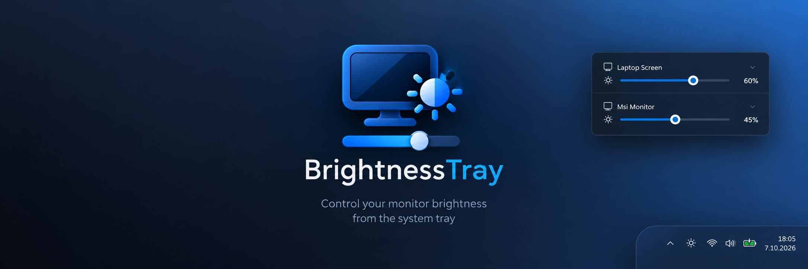

# BrightnessTray

A lightweight, zero-idle-CPU Windows 11 system tray application for controlling external monitor brightness via DDC/CI (Monitor Configuration API) and internal panels via WMI.

Designed exclusively for Windows 11 with native Mica glass material, system accent color integration, and Per-Monitor V2 DPI scaling.

---

## ✨ Features

- **Hardware Brightness Control**: Real DDC/CI monitor hardware brightness adjustment via Win32 `dxva2.dll` (no software overlays or color tinting).
- **Internal Panel Support**: Automatic WMI fallback for laptops and built-in displays.
- **Windows 11 Native UI**:
  - Dark Mica backdrop material matching native Windows 11 Quick Settings.
  - Windows 11 Quick Settings slider visuals (4px track, system accent color fill, elevated circular thumb).
  - Segoe Fluent Icons typography and smooth micro-interactions.
- **Zero Idle CPU**: Purely event-driven message loop. When the flyout is closed, no background timers, polling loops, or worker threads are active.
- **Lazy Lifecycle**: Flyout window and GDI resources are instantiated on demand when opened and fully disposed shortly after closing to maintain a minimal working set.
- **Optimistic UI**: Instant, butter-smooth slider updates and mouse-wheel stepping with asynchronous, debounced hardware writes.
- **Inline Renaming**: Double-click or click the pencil icon to assign persistent custom aliases to your displays.
- **Start with Windows**: Native context-menu toggle with registry Run key integration.
- **Per-Monitor V2 DPI Aware**: Pixel-perfect scaling on mixed-DPI multi-monitor setups (100%, 125%, 150%, 200%).
- **Portable**: Can be published as a single standalone executable with no runtime or installation required.

---

## 🖥️ Requirements

- **Operating System**: Windows 11 (64-bit, build 22621 or higher recommended for Mica backdrop)
- **Monitors**: External monitors with DDC/CI enabled in their on-screen display (OSD) menus
- **Runtime**: .NET 8.0 Windows Desktop Runtime (or use the self-contained portable executable)

---

## 🚀 Quick Start & Usage

### Controls
- **Left-Click Tray Icon**: Open or close the brightness flyout.
- **Slider Drag**: Adjust monitor brightness from 0% to 100%.
- **Mouse Wheel over Slider/Row**: Step brightness up or down by 5%.
- **Middle-Click Tray Icon**: Quickly toggle brightness between mute (0%) and your previous level.
- **Pencil Icon / Double-Click Name**: Edit monitor display name inline (press Enter to save, Esc to cancel).
- **Right-Click Tray Icon**:
  - **Start with Windows**: Enable or disable automatic launch on Windows startup.
  - **Exit**: Cleanly terminate the application and release all resources.

---

## 🛠️ Building from Source

### Prerequisites
- [.NET 8 SDK](https://dotnet.microsoft.com/download/dotnet/8.0)
- Windows 11 x64

### Debug Build
```pwsh
dotnet build -c Debug
dotnet run -c Debug
```

### Produce Portable Single-File Executable
To generate a single, standalone executable that runs without requiring .NET 8 to be pre-installed:
```pwsh
dotnet publish -c Release -r win-x64 --self-contained true -p:PublishSingleFile=true -p:EnableCompressionInSingleFile=true -p:IncludeNativeLibrariesForSelfExtract=true -o dist/
```
The output file will be located at `dist/BrightnessTray.exe`.

---

## 📁 Project Structure

```
BrightnessTray/
├── assets/
│   └── brightnesstray-github-banner.png # GitHub README banner
├── Controls/
│   ├── FluentLabel.cs          # DPI-aware GDI+ ClearType text labels
│   ├── FluentMenuItem.cs       # Windows 11 Fluent context menu items
│   ├── FluentSlider.cs         # Windows 11 Quick Settings style brightness slider
│   ├── FluentToggleMenuItem.cs # Win11 toggle-switch menu items
│   ├── FluentTypography.cs     # Segoe UI Variable & Segoe Fluent Icons helper
│   └── MonitorRowControl.cs    # Per-monitor card with slider, icon, and rename box
├── Native/
│   ├── AnimationInterop.cs     # Easing and timing utilities
│   ├── CompositeBrightnessProvider.cs # Combines DDC/CI and WMI providers
│   ├── DdcCiProvider.cs        # Win32 dxva2.dll DDC/CI monitor API P/Invoke
│   ├── DisplayConfigInterop.cs # CCD DisplayConfig display topology detection
│   ├── DwmInterop.cs           # Windows 11 DWM Mica backdrop & window attributes
│   ├── IBrightnessProvider.cs  # Brightness provider interface
│   ├── IconRenderer.cs         # Dynamic taskbar tray icon generator
│   ├── MemoryInterop.cs        # Console attachment for lifecycle diagnostics
│   ├── MonitorInfo.cs          # Monitor metadata data structure
│   ├── ShellInterop.cs         # Shell32 taskbar position detection
│   ├── SystemMessageListenerWindow.cs # Top-level message sink for OS events
│   ├── TaskbarInterop.cs       # Taskbar notification helpers
│   └── WmiProvider.cs          # WMI WmiMonitorBrightness internal panel control
├── Services/
│   ├── AutoStartManager.cs     # Registry Run key startup registration
│   ├── BrightnessService.cs    # Asynchronous, debounced hardware writes
│   ├── MonitorNameResolver.cs  # EDID and custom alias resolver
│   └── SettingsService.cs      # Debounced atomic JSON settings persistence
├── UI/
│   ├── FluentContextMenu.cs    # Fluent right-click context menu container
│   ├── FluentMenuRenderer.cs   # Windows 11 custom menu chrome renderer
│   ├── FlyoutGdiCache.cs       # Pre-cached GDI fonts and typography brushes
│   └── Theme.cs                # Design tokens (spacing, radii, colors, metrics)
├── FlyoutForm.cs               # Main popup flyout with lazy lifecycle
├── Program.cs                  # Entry point with single-instance mutex
├── TrayApplicationContext.cs   # Core application message loop & tray coordinator
└── app.manifest                # Declares Windows 11 compatibility & PerMonitorV2
```

---

## 📜 License

MIT License.
